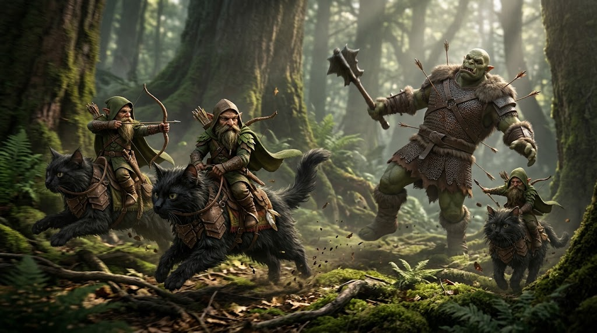

# Gnome Rangers

A third-person fantasy action RPG built in [Godot](https://godotengine.org/). You are a tiny gnome
ranger riding an armoured black cat. At your scale, the low-level mobs of an ordinary fantasy RPG
(orcs, goblins, giant rats, wolves, spiders) are the bosses.



Combat follows familiar third-person action-RPG mechanics (Elden Ring, Dark Souls, Skyrim):
lock-on, stamina, dodge rolls with i-frames, light and heavy attacks, bow aiming, telegraphed
boss attacks and checkpoint respawns. The twist is that you can whistle up your cat, fight
mounted with a bow, and pounce.

## Status

**MVP vertical slice: playable end to end.** Title screen, then Rootfall Hollow: a forest
approach path, a cat to call and ride, a fog gate, a checkpoint, and one boss fight against
Grukk the Ironjaw (an orc brute about four times your height). Death respawns you at the
checkpoint with Grukk reset; defeating him shows the victory screen. Pause and settings menus
and a HUD (health, stamina, boss bar, lock-on marker) are in.

Honest limits: one level and one boss; audio is a single synthesised ambient loop (no combat
SFX or music); animation clips for some moves are substitutions (see `assets/manifest.yaml`);
there is no save system beyond the in-run checkpoint; balance has been tuned by a scripted bot
(see Testing), not by human playtesting. Perf logs live in `docs/perf/`.

What comes next (Giant Rat Matriarch, Goblin Shaman, Hunting Spider, Dire Wolf, ranger squad,
Godot 4.8) is the "Later" list in [`PLAN.md`](PLAN.md#later-not-on-the-board-until-the-mvp-consolidation-lands).
[`PLAN.md`](PLAN.md) has the full plan and art direction;
[`ARCHITECTURE.md`](ARCHITECTURE.md) has the code conventions and module map.

## Requirements

- Godot **4.7.2-stable** standard build (pinned in `tools/godot-version.txt`;
  `tools/get_godot.sh` installs it)
- A Vulkan-capable GPU for the real game (Forward+ renderer); tests run headless without one
- Python 3.10+ for `gdtoolkit` (`requirements-dev.txt`) and the asset tools
- Optional: Blender (headless) and a Meshy API key, only to regenerate assets

## Controls

| Action | Keyboard and mouse | Gamepad |
|---|---|---|
| Move | W A S D | Left stick |
| Look | Mouse | Right stick |
| Sprint | Left Shift | Left stick click |
| Dodge roll | Space | B / Circle |
| Light attack | Left mouse | X / Square |
| Heavy attack | Right mouse | Y / Triangle |
| Aim bow | Q | Left trigger |
| Fire bow | Left mouse while aiming | Right trigger |
| Lock on | Middle mouse | R1 |
| Switch lock target | Mouse wheel | D-pad left / right |
| Call cat / mount / dismount | C | D-pad down |
| Interact (rest at checkpoint) | E | A / Cross |
| Pause | Esc | Start |

Bindings live in `project.godot` as named InputMap actions; the table is a summary, so check
the Input Map editor if you rebind.

## Stack

- Godot **4.7.2-stable** (standard build), typed GDScript, Forward+ renderer, Jolt physics
- GUT for unit and integration tests; gdtoolkit (`gdlint`, `gdformat`) for lint and formatting
- 3D assets generated with [Meshy](https://www.meshy.ai/), with Blender (headless) for cleanup and
  quadruped rigging, plus CC0 assets from Quaternius, Kenney, Poly Haven and ambientCG

## Develop

```sh
tools/get_godot.sh                                   # install pinned Godot to ~/.local/bin/godot
pip install -r requirements-dev.txt                  # gdlint + gdformat (gdtoolkit 4.x)

godot --headless --import --path .                   # import assets (first run / after asset changes)
godot --path .                                       # run the project (opens the sandbox)
godot --headless --quit --path .                     # parse check

godot --headless -s addons/gut/gut_cmdln.gd -gdir=res://tests -gexit   # tests (GUT)
gdlint . && gdformat --check .                       # lint and format check (addons/ excluded)
gdformat .                                           # apply formatting

tools/capture/capture.sh levels/sandbox/sandbox.tscn /tmp/sandbox.png [--camera <NodePath>] [--frames N]
tools/capture/rootfall.sh [out_dir]                  # the three fixed Rootfall Hollow captures
tools/capture/perf.sh [--tier high|dev] [--seconds N] [--out log.txt]   # fly-through fps log
tools/capture/final_slice.sh                         # MVP screenshots -> docs/captures/final_*.png
tools/capture/fight_perf.sh                         # full-fight fps log -> docs/perf/final_fight_fps.txt
```

`godot --path .` runs `main.tscn` (title screen, then the level). Look-dev captures can load
other scenes through the capture tools above.

### Testing

`-gdir=res://tests` runs everything: unit tests (`tests/unit/`) and integration tests
(`tests/integration/`). `test_bot_fight.gd` plays the real game headless: a scripted bot
(`tests/helpers/fight_bot.gd` plus its foot and saddle tactics) presses the real InputMap
actions through the full level, and must beat Grukk on foot and mounted, and survive a
death/respawn. Run it alone with:

```sh
godot --headless -s addons/gut/gut_cmdln.gd -gdir=res://tests/integration -gselect=test_bot_fight -gexit
```

The bot runs on a fixed physics clock and seeded RNG, so a failing fight is reproducible.

**Captures** need a real Vulkan device, so they cannot use `--headless`. `capture.sh` uses
`xvfb-run` when installed (this is what CI does, with Mesa lavapipe: `apt install xvfb
mesa-vulkan-drivers`). Without Xvfb it falls back to the live Wayland/X session
(`WAYLAND_DISPLAY`/`DISPLAY`), which is the path on a desktop dev box. `CAPTURE_SIZE=WxH`
changes the resolution (default 1280x720).

## Asset pipeline

Every 3D asset is declared in `assets/manifest.yaml` and built by `tools/meshy/meshy.py`
(Meshy text-to-3D, PBR refine, auto-rig, animate) or, for the quadruped cat, by headless Blender
(`tools/blender/rig_cat.py`). Set `MESHY_API_KEY` in the environment (never commit it).
`python3 tools/meshy/meshy.py plan` is a free dry run that lists tasks and the credit estimate.
See [`tools/meshy/README.md`](tools/meshy/README.md).

**Meshy budget:** at most 2,000 credits for the whole MVP; about 465 credits have been spent so
far. Every paid task is appended to `assets/meshy-ledger.jsonl`, so check `plan` before generating
anything new.

## Contributing

Read [`CONTRIBUTING.md`](CONTRIBUTING.md) and [`ARCHITECTURE.md`](ARCHITECTURE.md) before
changing code.

## License

- Code: [MIT](LICENSE)
- Generated art, audio and concept art: [CC-BY-4.0](assets/LICENSE-ASSETS.md)
- Third-party CC0 assets (Poly Haven textures) and the OFL fonts (Cinzel, Alegreya Sans, licences
  in `ui/fonts/`) are credited in `assets/CREDITS.md`.
- Meshy output is used under the terms of the Meshy plan that generated it; see `assets/CREDITS.md`.
