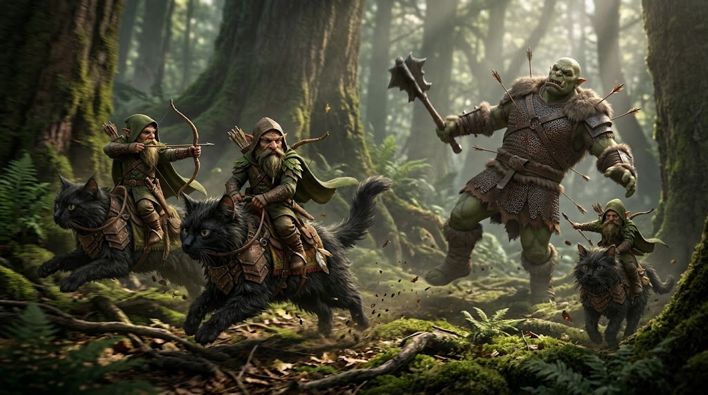

# Gnome Rangers

A third-person fantasy action RPG built in [Godot](https://godotengine.org/). You are a tiny gnome
ranger riding an armoured black cat. At your scale, the low-level mobs of an ordinary fantasy RPG
(orcs, goblins, giant rats, wolves, spiders) are the bosses.

Combat follows familiar third-person action-RPG mechanics (Elden Ring, Dark Souls, Skyrim):
lock-on, stamina, dodge rolls with i-frames, light and heavy attacks, bow aiming, telegraphed
boss attacks and checkpoint respawns. The twist is that you can whistle up your cat, fight
mounted with a bow, and pounce.

## Status

**Pre-alpha: planning only.** There is no playable build yet. The MVP vertical slice is one boss
fight (Grukk the Ironjaw, an orc brute about four times your height) in a single forest arena.
[`PLAN.md`](PLAN.md) has the full plan, art direction and work breakdown, and
[`ARCHITECTURE.md`](ARCHITECTURE.md) has the code conventions.

## Stack

- Godot **4.7.2-stable** (standard build), typed GDScript, Forward+ renderer, Jolt physics
- GUT for unit and integration tests; gdtoolkit (`gdlint`, `gdformat`) for lint and formatting
- 3D assets generated with [Meshy](https://www.meshy.ai/), with Blender (headless) for cleanup and
  quadruped rigging, plus CC0 assets from Quaternius, Kenney, Poly Haven and ambientCG

Build, run and test instructions arrive with the scaffold (card 1).

## Contributing

Read [`CONTRIBUTING.md`](CONTRIBUTING.md) and [`ARCHITECTURE.md`](ARCHITECTURE.md) before
changing code.

## License

- Code: [MIT](LICENSE)
- Generated art, audio and concept art: [CC-BY-4.0](assets/LICENSE-ASSETS.md)
- Third-party CC0 assets are listed in `assets/CREDITS.md` as they are added.
